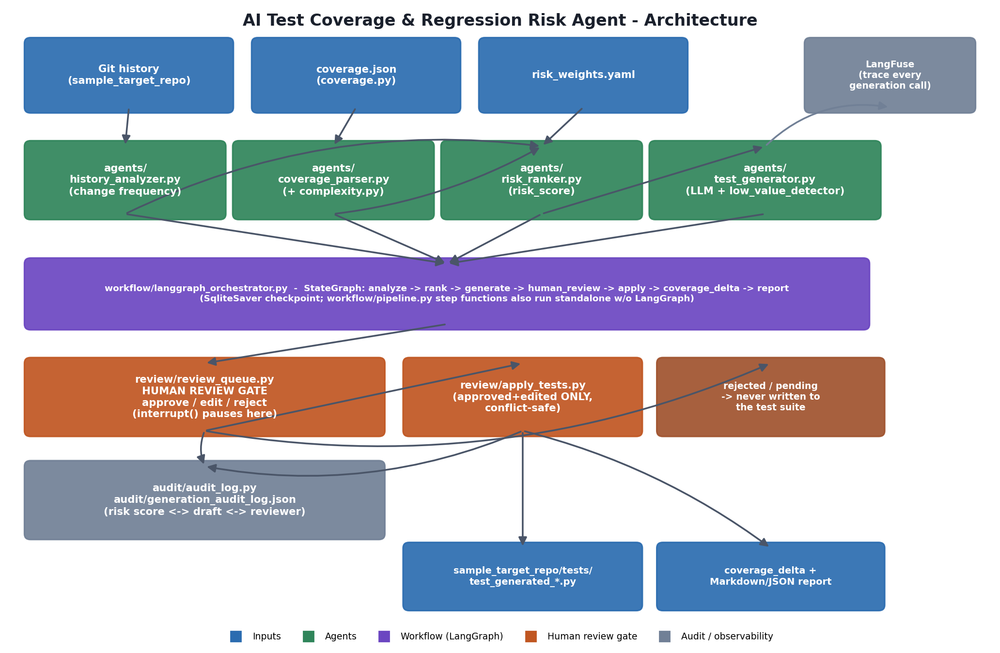

# AI Test Coverage & Regression Risk Agent

> **Data privacy note:** everything this repo analyzes is synthetic demo
> data (`sample_target_repo/`) created specifically for this exercise. Do
> not point it at real production, customer, or confidential code without
> your own review of your organization's data-handling requirements.

## Project Overview

Coverage reports tell you *where* the gaps are, not which ones matter. A
rarely-touched utility function and a payment-calculation branch that
changes every sprint look identical on a coverage report - but only one of
them is likely to cause the next regression.

This agent analyzes git diff history and a `coverage.py` report together,
ranks untested code paths by **risk = change frequency x complexity x
coverage gap** (never coverage gap alone), and drafts candidate pytest
tests for the highest-risk paths. A human explicitly **approves, edits, or
rejects** every single draft before it is written to the test suite -
nothing auto-merges. Every generation call and every review decision is
traced (LangFuse) and logged to an append-only audit trail linking the
test back to its risk score and its reviewer.

Reference result from the included demo (`sample_target_repo/`, a
synthetic storefront with deliberately uneven git history and coverage):
the agent ranked `billing/discounts.py::apply_discount` (changed 4x,
cyclomatic complexity 3, 100% uncovered) as the #1 risk - above every
other function with the same 100% coverage gap but far less churn. After
human review (4 drafts edited with real assertions and approved, 2
rejected as lower priority), overall coverage went **23.9% -> 93.5%**,
counted only from the approved tests.

## Architecture Description



```
 git history ─┐
              ├─▶ agents/history_analyzer.py ──┐
 coverage.json┤   agents/coverage_parser.py     ├─▶ agents/risk_ranker.py ─▶ agents/test_generator.py
 risk_weights ┘   (+ agents/complexity.py)     ┘        (risk_score)           (LLM + low_value_detector)
                                                                                        │
                                                                              LangFuse traces every call
                                                                                        │
                                                                                        ▼
            workflow/langgraph_orchestrator.py  -  LangGraph StateGraph:
            analyze -> rank -> generate -> human_review -> apply -> coverage_delta -> report
                                     (interrupt() + SqliteSaver checkpoint)
                                                        │
                                                        ▼
            review/review_queue.py  -  HUMAN REVIEW GATE: approve / edit / reject
                                      (nothing auto-merges; rejected/pending never written anywhere)
                                                        │
                                                        ▼
            review/apply_tests.py  -  writes ONLY approved/edited drafts, conflict-safe
                                                        │
                              ┌─────────────────────────┴─────────────────────────┐
                              ▼                                                    ▼
          sample_target_repo/tests/test_generated_*.py          workflow/coverage_delta.py -> report
                                                        │
                                                        ▼
                      audit/audit_log.py -> audit/generation_audit_log.json
                      (every draft <-> its risk score <-> its reviewer)
```

Orchestrated as a **LangGraph** `StateGraph` with a genuine human-in-the-loop
pause: the `human_review` node calls `interrupt()`, backed by a SQLite
checkpointer, so the pipeline really stops - across separate CLI
invocations / process runs - until a human has acted via `review`. Every
pipeline step is also a plain Python function in `workflow/pipeline.py`, so
the exact same logic runs through a dependency-free sequential engine if
`langgraph` isn't installed (`--engine simple`, or automatic fallback).
Both engines are covered by the test suite.

### Project layout

```
README.md              DECISIONS.md             .env.example
cli.py                  pytest.ini               conftest.py
core/                   # shared infrastructure
  config.py               paths, .env loading, Settings, RiskWeights
  models.py               FunctionSpan / RiskCandidate / TestDraft dataclasses
  tracing.py              LangFuse wrapper (safe no-op if unconfigured)
agents/                 # Diff & History Analyzer, Coverage Ingestion, Risk Ranking, Test Draft Generator
  history_analyzer.py     change-frequency via `git` CLI, matched per-commit (no GitPython)
  coverage_parser.py      parses `coverage json`, maps missing lines -> functions
  complexity.py           AST-based function discovery + cyclomatic complexity
  repo_scanner.py         ties the three together into RiskCandidates
  risk_ranker.py          combines change_frequency x complexity x coverage_gap -> risk_score
  test_generator.py       drafts pytest tests (LLM, with an honest template fallback)
  llm_client.py           thin Anthropic wrapper
  low_value_detector.py   flags drafts with no real assertions
workflow/               # LangGraph orchestration
  langgraph_orchestrator.py   StateGraph + interrupt() + SqliteSaver
  pipeline.py                 shared step functions (both engines)
  coverage_delta.py           re-runs coverage, reports the improvement
  reporting.py                renders the Markdown/JSON run report
review/                 # Human Review Gate
  review_queue.py          on-disk JSON queue: approve / edit / reject
  apply_tests.py            writes ONLY approved/edited drafts, conflict-safe
audit/                  # Audit trail
  audit_log.py              append-only JSONL + JSON-array export
  generation_audit_log.json populated snapshot from the reference run
docs/
  architecture.png
webui/                  # optional local control panel (bonus - see "Web UI" below)
  app.py                    Flask routes, calling agents/workflow/review/audit directly
  static/index.html          vanilla HTML/CSS/JS, no build step
sample_target_repo/    # synthetic seed repo used for the demo (see its own README)
tests/                  # 65 unit/integration tests for the agent itself
config/risk_weights.yaml
```

## Setup Instructions

```bash
cd test-risk-agent
python -m venv .venv
source .venv/Scripts/activate      # Windows Git Bash / macOS / Linux: source .venv/bin/activate
pip install -r requirements.txt
cp .env.example .env                # fill in keys below if you have them - all optional
```

Requires Python 3.10+ and `git` on PATH. Verify your setup with the agent's
own test suite:

```bash
pytest   # 65 tests, ~1-2 min
```

## Environment Variables

All variables are **optional** - the agent runs end-to-end with none of
them set, using safe local fallbacks. Copy `.env.example` to `.env` and
fill in what you have; never commit the real `.env` (already in
`.gitignore`).

| Variable | Purpose | If unset |
|---|---|---|
| `ANTHROPIC_API_KEY` | Lets Claude draft real test bodies | Falls back to an honest, clearly-labeled TODO template (never a fake passing test) |
| `ANTHROPIC_MODEL` | Model id (default `claude-sonnet-5`) | uses default |
| `LANGFUSE_PUBLIC_KEY` / `LANGFUSE_SECRET_KEY` | Traces every generation call + review decision | Tracing becomes a safe no-op (pipeline still runs) |
| `LANGFUSE_HOST` | Self-hosted LangFuse | defaults to LangFuse Cloud |
| `RISK_LOOKBACK_DAYS` / `RISK_TOP_N` | Tuning | 180 days / top 10 |

## How to Run the Risk Analysis

All commands run from `test-risk-agent/` with the venv active.

```bash
# 1. Produce the input coverage report for the seed repo
python cli.py baseline

# 2. Analyze git history + coverage.json -> rank -> draft candidate tests,
#    then pause for human review
python cli.py analyze
```

`analyze` prints the risk-ranked table (file, function, risk score, change
frequency, complexity, coverage gap) and the list of drafted candidates,
then pauses - nothing is written to the test suite yet. Useful flags:
`--repo-root`, `--branch`, `--coverage-json`, `--lookback-days`, `--top-n`,
`--engine {auto,langgraph,simple}` (default `auto`: uses LangGraph if
installed, otherwise the dependency-free engine).

`--branch <name>` (accepted by both `baseline` and `analyze`) checks out
that branch in `--repo-root` first, so the git-history and coverage inputs
both reflect it. It refuses - rather than stashing or force-checking-out -
if the working tree has uncommitted changes, since the CLI has no way to
know whether you want those changes kept:

```bash
python cli.py baseline --branch payments-rework
python cli.py analyze --branch payments-rework
```

## How to Review/Approve Generated Tests

```bash
python cli.py review
```

For each pending draft this shows: the file/function, its risk score and
rationale, the full generated test code, and any **low-value warning**
(e.g. "only verifies that an exception is raised, without checking its
type/message" or "body is an empty TODO stub"). You then choose:

- **`a` approve** - use the draft as-is
- **`e` edit** - opens the draft in a temp file for you to rewrite, then
  re-runs the low-value check on your edit before saving
- **`r` reject** - recorded with your reason, never written anywhere
- **`s` skip** - leave pending for a later review session

`python cli.py status` shows queue counts at any time. Once every draft
has a decision, finalize the run:

```bash
python cli.py apply
```

This resumes the paused LangGraph run (or the simple-engine state),
writes **only** approved/edited drafts into `sample_target_repo/tests/`
(flagging - never overwriting - any filename conflict with existing
content), re-runs coverage, and writes the final report to
`data/reports/latest_report.md`.

### Web UI (optional, no commands needed)

Everything above - baseline, analyze, review (approve/edit/reject), apply -
is also available as a local control panel, so you don't need to type a
CLI command for each step:

```bash
python cli.py ui           # or: python webui/app.py
# -> Risk Agent Control Panel: http://127.0.0.1:5151
```

Open that URL in a browser. It's a small Flask app (`webui/app.py` +
`webui/static/index.html`) calling the exact same `agents/`, `workflow/`,
`review/`, `audit/` functions the CLI uses - nothing is duplicated. It
always drives the dependency-free `workflow.pipeline` engine (a stateless
HTTP request per click is a better fit than the LangGraph engine's
cross-process `interrupt()`/resume thread); the LangGraph engine with its
real pause remains available via `python cli.py analyze --engine
langgraph` for that orchestration path. Covered by
`tests/test_webui.py` (Flask test client, no real server needed).

## How to Inspect AI Decisions (Audit Log + LangFuse)

Every test-generation call and every review decision is recorded twice:

1. **Audit log** - `data/audit_log.jsonl` (append-only, written live) and
   `audit/generation_audit_log.json` (a pretty-printed JSON-array snapshot
   refreshed on every `apply`). Each entry carries the draft id, file,
   function, **risk_score and its full risk_components breakdown**, the
   decision (`edit`/`approve`/`reject`), the reviewer, and - if LangFuse is
   configured - the `trace_id` to cross-reference. See `DECISIONS.md` for
   the narrative version of the reference run's decisions.
2. **LangFuse** - set `LANGFUSE_PUBLIC_KEY`/`LANGFUSE_SECRET_KEY` in `.env`
   (free tier at [cloud.langfuse.com](https://cloud.langfuse.com)) and every
   call to `agents/test_generator.py::generate_draft` opens a trace/span
   with the candidate's file, qualname, risk score, and components as
   metadata, plus the generated code and whether it was LLM- or
   template-generated as output - open the LangFuse dashboard and filter by
   trace name `test_generation`. Without keys set, `core/tracing.py`
   degrades to a safe no-op (confirmed by `tests/test_config.py` and the
   generator tests) so the pipeline never depends on LangFuse being present.

## Known Limitations

- **Test intent vs. current behavior**: an LLM- or human-drafted test can
  assert the code's *current* (possibly buggy) behavior instead of its
  *correct* behavior. Review the rationale and the function source, not
  just whether the draft passes - this is called out directly in each
  draft's low-value check, but is not something static analysis alone can
  catch.
- **Risk scoring is a heuristic**, not a guarantee - it approximates where
  regressions are likely. The weighting in `config/risk_weights.yaml` is a
  starting point (see `DECISIONS.md` for the reasoning); teams with a
  different regression profile should retune it.
- **Change-frequency attribution is commit-overlap based**: for each
  commit, function spans are re-parsed from that commit's own blob and
  matched by qualified name to today's functions, which avoids line-number
  drift but still treats a renamed function as brand-new with no prior
  history. A module-level constant edit (e.g. adding a dict entry outside
  any function body) correctly does **not** count toward a function's
  change frequency, even when it changes that function's behavior.
- **Low-value detection is heuristic, not semantic**: it checks for the
  *shape* of a test (real comparisons vs. trivial/empty assertions), not
  whether the assertions are actually correct.
- **`apply` re-runs the whole target-repo test suite via subprocess** to
  compute the coverage delta; on a very large real repo this is the
  dominant cost of a run, not the agent's own analysis.
